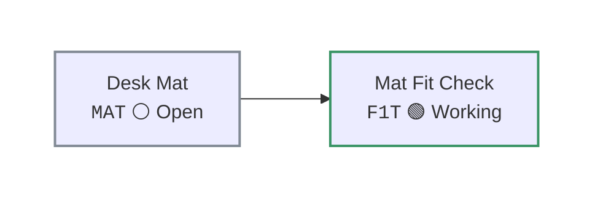

<!-- pursuits-md:graph -->

<!-- pursuits-md:graph-links -->

1. [Mat Fit Check](MAT/F1T%20-%20Mat%20Fit%20Check.md)

<!-- /pursuits-md:graph-links -->

# Desk Mat

## Description

Choose a mat that fits the desk and leaves room for the notebook.

## Acceptance Criteria

- [ ] a. Record a mat size that passes the fit check.

## Notes

1. 
