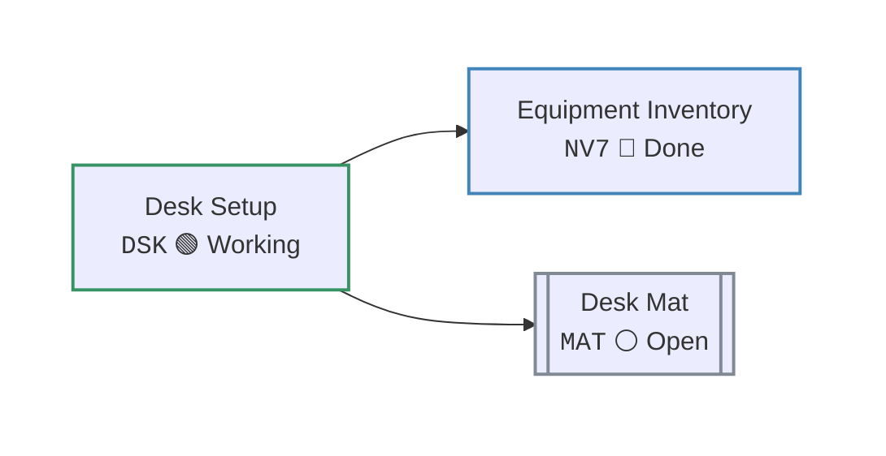

# Example Pursuits

Set up a desk for writing and video calls.

<!-- pursuits-md:graph -->

<!-- pursuits-md:graph-links -->

1. [Desk Setup](https://github.com/synodic-studio/pursuits-md/blob/v0.1.1-clarifications/examples/demo-vault/pursuits/DSK%20-%20Desk%20Setup.md)
2. [Equipment Inventory](https://github.com/synodic-studio/pursuits-md/blob/v0.1.1-clarifications/examples/demo-vault/pursuits/DSK/NV7%20-%20Equipment%20Inventory.md)
3. [Desk Mat](https://github.com/synodic-studio/pursuits-md/blob/v0.1.1-clarifications/examples/demo-vault/pursuits/DSK/MAT%20-%20Desk%20Mat.md)

<!-- /pursuits-md:graph-links -->
